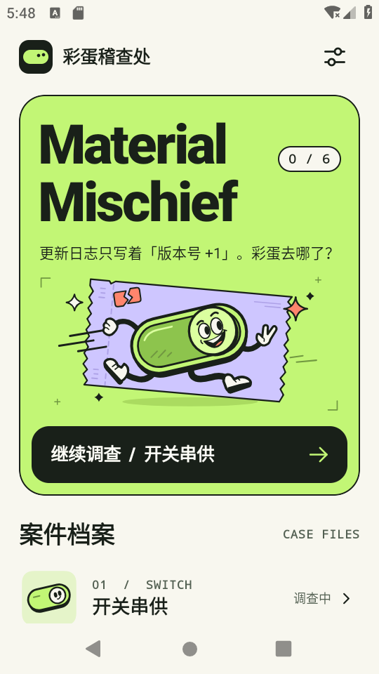
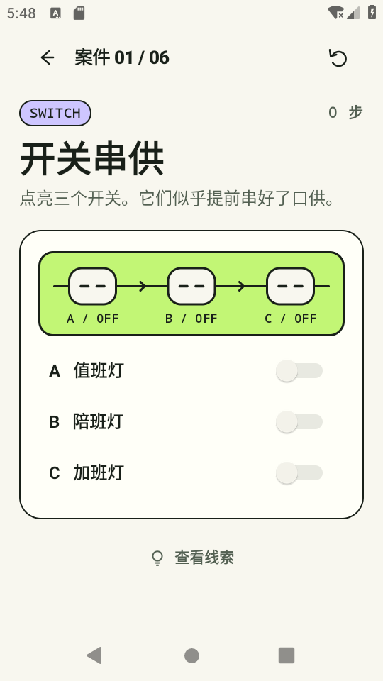
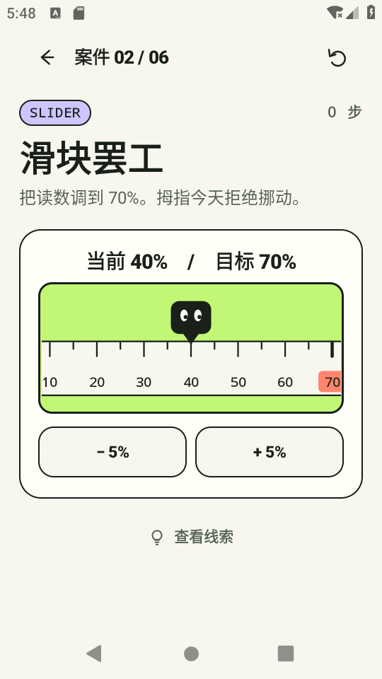

# Material Mischief

更新日志只有一句「版本号 +1」。作为彩蛋稽查员，你得把六个界面组件叫来问话，找出这次 Android 更新把彩蛋藏到了哪里。

**[下载 Android 安装包](https://github.com/Hycnyl/Material-Mischief/releases/latest/download/Material-Mischief.apk)** · [发行记录与校验文件](https://github.com/Hycnyl/Material-Mischief/releases)

支持 Android 6.0 及以上版本，简体中文，离线单机。APK 使用原生 Android View 与矢量插画，游戏无需申请任何权限。

<p>
  
  
  
</p>

## 六起案件

| 案件 | 报案记录 |
| --- | --- |
| 01 · 开关串供 | 我只碰了值班灯，陪班灯怎么也亮了？ |
| 02 · 滑块罢工 | 拇指今天带薪休假，刻度还得照常上班。 |
| 03 · 撤销套娃 | 系统说彩蛋已归档。那条回执本身也被收起来了。 |
| 04 · 浮钮越狱 | 每点一次，浮钮就逃往下一站。有人看见它的底座了吗？ |
| 05 · 通知叠叠乐 | 四条通知都记得早晨的一部分，请它们排好队作证。 |
| 06 · 版本号之外 | 在「关于手机」里敲敲版本号。彩蛋工程师留下了一本打卡簿。 |

从首页选任意案件。每案都有两级提示、独立保存的调查进度和个人最佳步数。找齐六件物证即可签收结案报告。拖动操作另有点按入口，设置里可以调整触感反馈与动态效果。

## 本地构建

安装 JDK 17 与 Android SDK Platform 35、Build Tools 35.0.0。将 Android SDK 路径设为 `ANDROID_HOME`，在项目根目录运行以下命令。

```sh
./gradlew assembleDebug
adb install -r app/build/outputs/apk/debug/app-debug.apk
```

也可用 Android Studio 打开项目，选择 `app` 并运行。

## 发布维护

推送到 `main` 时，GitHub Actions 会构建 APK。要发布新版本，先更新 `app/build.gradle` 中的版本号与版本代码，再推送与版本号对应的标签，例如 `v1.0.0`。工作流会把签名 APK 与 `SHA256SUMS.txt` 附到 GitHub Release。

发布密钥使用 PKCS#12，别名为 `mischief`。维护者可为仓库配置 `ANDROID_KEYSTORE_BASE64` 和 `ANDROID_KEYSTORE_PASSWORD` 两个 Actions secrets，让工作流签名。离线签名也可发布：

1. 向 `MM_KEYSTORE` 和 `MM_KEYSTORE_PASSWORD` 环境变量提供同一把发布密钥的本地路径及密码，运行 `./gradlew assembleRelease`。
2. 在 `signed-apks` 分支的版本标签目录下放入 `Material-Mischief.apk` 和 `commit.txt`。后者只含待发布源码的完整提交 SHA。
3. 推送版本标签。工作流会从该提交重新构建，逐项比较 APK 内容，并校验签名证书、应用 ID 和版本号。

发布证书 SHA-256 指纹为 `f87b42cab153ea16e9abe9a9cac7162c9455046bb78131bce497aa9a36fa5442`。
